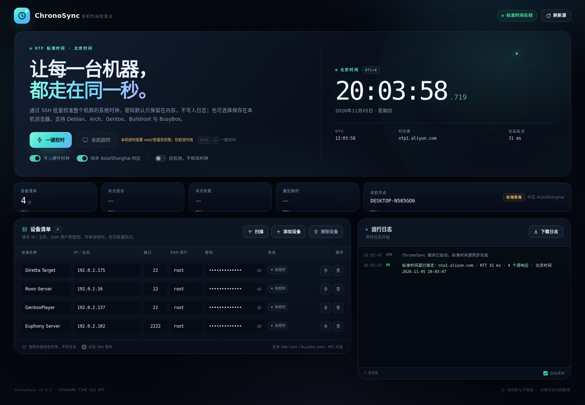

# ChronoSync · 多机时间校准台

一个用 Rust 实现的中文 Web 校时工具：从 NTP 获取标准时间，通过 SSH 一键校准整个机群。支持 Debian / Arch / Gentoo / Buildroot / BusyBox 等不同发行版，不需要在目标机上安装 NTP 客户端。

WebUI 通过 `include_str!` 编译进主程序，运行时不需要 `web/` 目录；发布包中的 `chronosync` / `chronosync.exe` 是单文件程序。

发布页（二进制包、源码包与 SHA256）：<https://github.com/harmonyosnews/chronosync/releases/tag/v1.0.2>

文档基线：2026-11-06。24 小时长稳测试已按项目决定取消，不列入本版验收或闸门。



## 项目文档

完整索引和单一事实源约定见 [docs/README.md](docs/README.md)。

| 文档 | 用途 |
| --- | --- |
| [使用手册](使用手册.md) | 安装、校时、扫描、排障 |
| [项目书](docs/项目书.md) / [可行性分析](docs/可行性分析.md) | 目标、范围、可行性结论 |
| [实施方案](docs/实施方案.md) | 架构、部署、回滚 |
| [开发手册](docs/开发手册.md) / [程序接口](docs/程序接口.md) | 代码结构、CLI/HTTP 契约 |
| [实测证据与复现](docs/实测证据与复现.md) / [实施与验收记录](docs/实施与验收记录.md) | 测试证据、验收结果 |
| [审计报告](docs/审计报告.md) / [Issues 整理](docs/Issues整理.md) | 风险、债务、问题台账 |
| [纪律与闸门](docs/纪律与闸门.md) / [工程纪律](工程纪律.md) | 质量闸门、工程规则 |
| [编译环境与静态编译](docs/程序编译环境的搭建与实施-静态编译.md) | 工具链、动态/静态构建 |
| [项目管理与排期](项目管理与排期.md) / [AGENTS.md](AGENTS.md) | 里程碑、代理规则 |

## 功能

- **NTP 标准时间源**：并行查询阿里云、Cloudflare、NTP Pool 等多个时间源，自动剔除离群值，并以 RTT 较低的结果作为标准时间。
- **一键批量校时**：填写 IP / 主机、SSH 端口、用户名和密码，一次校准所有设备；最多 8 台并发。
- **局域网扫描**：设备清单前的“扫描”按钮可扫描 IPv4 局域网，自动填入主机名和 IP；默认同时显示活跃但未开放 SSH 的主机，并用“无 SSH”标记，方便删除非目标设备。
- **单机校时 / 本机校时**：每台设备有独立执行按钮；运行 ChronoSync 的机器也可以直接校准（需要 root）。
- **仅检测模式**：只读取远程时间、时区和偏差，不写入任何时钟，适合上线前验证。
- **可移植写入命令**：通过 `date -u -s @epoch` 写入 UTC 绝对时间，兼容 GNU date 与 BusyBox date；写入失败时回退到 UTC 字符串。
- **智能 RTC 处理**：有 `/dev/rtc*` 时执行 `hwclock -w`；部分 Buildroot x86 固件没有 RTC 设备节点，会自动回退到 `hwclock --directisa -w`（先做只读探测）；两者都不可用时记录“无 RTC”并跳过，不影响系统时间校准。
- **可选北京时间时区**：目标时区不是 `Asia/Shanghai` 时，尝试通过 `timedatectl` 或 `/etc/localtime` 修正；没有 tzdata 的设备会记录警告。
- **实时日志 + 下载**：Web 控制台固定约 10 行日志视窗，超出后滚动查看；日志同时自动保存到磁盘，可在页面下载全部日志。
- **系统安装脚本**：`install.sh` 自动识别 systemd、OpenRC（GentooPlayer）、procd（iStoreOS）、AudioSys/Buildroot，并把程序安装到 `/opt/chronosync`；AudioSys 还会在持久分区写入开机钩子。
- **默认局域网访问**：默认监听 `0.0.0.0`，局域网内可直接打开 WebUI；可配合 `--auth` 或反向代理使用。NTP 全部不可达时默认拒绝校时，避免把所有机器写到一个错误的本机时间。
- **清除设备**：设备清单工具栏提供“清除设备”；确认后移除所有行及浏览器已保存的 SSH 密码，不删除运行日志。
- **可选记住密码**：默认密码只在内存中；勾选“记住 SSH 密码”后，密码以明文保存在当前浏览器 localStorage，刷新/重启浏览器后可恢复。仅建议在个人受信任电脑使用，清除设备会同时删除已保存密码。

## 工作原理

```text
                    NTP / SNTP（UDP 123）
 ntp.aliyun.com ─────────────┐
 cn.pool.ntp.org ────────────┼──> ChronoSync ── SSH ──> 各台 Linux 设备
 time.cloudflare.com ────────┘       │                     │
                                     │                     ├─ date -u -s @epoch
                                     │                     ├─ hwclock -w / --directisa -w（可选）
                                     │                     └─ 时区修正（可选）
                                     └─ Web 控制台 / 日志
```

每台设备执行两阶段操作：

1. **预检**：读取主机名、当前 UTC epoch、本地时间、时区；与 NTP 标准时间比较，计算“快 / 慢”多少。
2. **写入**：按当前标准时间四舍五入到整秒，写入该 epoch；可选写 RTC 和修正时区；随后读取远程时间做校验。

> 目标机不需要能访问外网，也不需要安装 NTP 服务；所有时间来源于运行 ChronoSync 的这台控制机。

## 快速开始

### 0. 使用安装脚本（推荐部署方式）

预编译包内包含 `install.sh`。解压后执行：

```bash
tar -xzf chronosync-1.0.2-linux-x86_64-v1-20261105-200000.tar.gz
cd chronosync-1.0.2-linux-x86_64-v1-20261105-200000

# 推荐：默认监听 0.0.0.0:8686，并启用访问认证
sudo ./install.sh --auth admin:'换成强密码'

# 只允许本机访问（配合 SSH 隧道）
sudo ./install.sh --bind 127.0.0.1

# 无认证仅适合完全可信的内网
sudo ./install.sh

# 只看安装计划，不修改系统
./install.sh --dry-run

# 查看状态 / 卸载（默认保留日志）
./install.sh status
sudo ./install.sh uninstall
```

安装器会自动识别：

- **systemd**（Debian、Ubuntu 等）：安装 `chronosync.service` 并 enable/start。
- **OpenRC**（GentooPlayer 等）：安装 `/etc/init.d/chronosync` 并加入 default runlevel。
- **procd**（iStoreOS 等）：安装 procd 服务并启用。
- **AudioSys/Buildroot**：程序安装到 `/opt/chronosync`；同时在持久分区 `/audiosys/chronosync` 保存二进制、启动脚本和日志，并往 CONFIG 分区 `networkfs.sh` 写入幂等开机钩子。`/opt` 是内存盘，重启后由钩子从 `/audiosys/chronosync` 恢复并启动。还提供 `chronosyncctl {start|stop|restart|status|logs}`。
- **BusyBox/SysV**：安装 `/etc/init.d/S99chronosync`（如果根文件系统在内存中，重启后可能丢失；AudioSys 请使用上面的持久钩子方案）。

常用安装参数：

| 参数 | 说明 |
| --- | --- |
| `--bind ADDR` | 控制台监听地址，默认 `0.0.0.0`。 |
| `--port PORT` | 控制台端口，默认 `8686`。 |
| `--auth USER:PASS` | 可选的 HTTP Basic 认证；以 root-only 文件保存，不进入进程参数。 |
| `--log-dir DIR` | 日志目录；普通系统默认 `/var/log/chronosync`，AudioSys 默认 `/audiosys/chronosync/logs`。 |
| `--binary PATH` | 指定二进制路径；默认使用安装脚本旁边的 `chronosync`。 |
| `--no-start` | 只安装/注册服务，不立即启动。 |
| `--dry-run` | 只打印检测结果和安装计划。 |
| `--purge` | 卸载时同时删除日志/持久目录。 |

安装后的服务默认以 root 运行，因为“本机校时”和 RTC direct ISA 回退需要 root 权限；请限制控制台访问范围。

### 1. 编译

需要 Rust 1.89+、`cc`（ring 加密后端需要 C 编译器）：

```bash
cd chronosync
cargo build --release
```

生成的可执行文件：`target/release/chronosync`。

如果你拿到的是预编译包（例如 `chronosync-1.0.2-linux-x86_64-v1-20261105-200000.tar.gz`），解压后可直接使用其中的 `chronosync`。该二进制在 Ubuntu 26.04（glibc 2.43）上构建，要求目标系统 **glibc ≥ 2.39**；更旧的系统请按上面的源码方式在目标系统本地编译。

### 2. 启动 Web 控制台

**仅进行远程校时（推荐，不需要 root）：**

```bash
# 默认监听 0.0.0.0:8686；强烈建议设置访问认证
./target/release/chronosync --port 8686 --auth admin:'换成强密码'
```

**只允许本机访问 / 需要本机校时时：**

```bash
# 仅本机 HTTP，可配合 SSH 隧道
./target/release/chronosync --bind 127.0.0.1 --port 8686

# 需要“本机校时”功能时再使用 root
sudo ./target/release/chronosync --bind 127.0.0.1 --port 8686
```

默认监听 `0.0.0.0:8686`。在浏览器打开 `http://控制机IP:8686`（本机用 `http://127.0.0.1:8686`）：

1. 点击“添加设备”，填写设备名称、IP / 主机、SSH 端口、SSH 用户（例如 `root`）和密码。
2. 建议先打开“仅检测”，点“检测全部设备”确认网络、SSH 和当前偏差。
3. 关闭“仅检测”，点“一键校时”；页面会显示确认弹窗。
4. 观察行内状态和右侧日志，完成后可下载日志。

设备地址、端口、用户名会被浏览器记住（不含密码）；刷新页面后需要重新输入密码。

设备清单前的“扫描”按钮可以自动发现局域网设备：留空扫描会自动探测控制机所在 IPv4 网段；也可以填写 `192.0.2.0/24` 这样的网段。扫描只做 TCP 22 探测和 ARP 邻居表读取，不会登录主机；主机名来自反向 DNS，无法解析的设备显示 IP 和“无 SSH”提示。扫描结果会合并现有清单，不会重复添加同一 IP。

### 3. 从其他电脑访问（重要）

控制台默认监听所有网卡，局域网内可访问 `http://控制机IP:8686`。但 WebUI 使用明文 HTTP，SSH 密码会经过网络；请在可信内网运行，并至少启用访问认证：

```bash
sudo ./target/release/chronosync \
  --bind 0.0.0.0 \
  --port 8686 \
  --auth admin:'请换成一个强密码'
```

如果只想允许本机访问，改为：

```bash
./target/release/chronosync --bind 127.0.0.1 --port 8686
```

跨机器使用时，也可以使用 SSH 端口转发（链路加密）：

```bash
ssh -L 8686:127.0.0.1:8686 用户名@构建机IP
```

然后在本机浏览器打开 `http://127.0.0.1:8686`。

也可以通过环境变量传递认证信息，避免密码出现在进程列表里：

```bash
export CHRONOSYNC_AUTH='admin:请换成一个强密码'
sudo -E ./target/release/chronosync --bind 0.0.0.0 --port 8686
```

HTTP Basic 认证只是访问控制，**不是加密**。不要把控制台直接暴露到公网，也不要通过不可信 Wi-Fi 传输 SSH 密码。

## 命令行参数

| 参数 | 默认值 | 说明 |
| --- | --- | --- |
| `--bind <ADDR>` | `0.0.0.0` | Web 控制台监听地址，默认局域网可访问。建议启用 `--auth` 或使用 SSH 隧道。 |
| `--port <PORT>` | `8686` | Web 控制台端口。 |
| `--ntp-servers <LIST>` | `ntp.aliyun.com,ntp1.aliyun.com,cn.pool.ntp.org,time.cloudflare.com` | 逗号分隔的 NTP/SNTP 服务器。 |
| `--auth <user:pass>` | 无 | 可选 HTTP Basic 认证；也支持环境变量 `CHRONOSYNC_AUTH`。 |
| `--log-dir <DIR>` | `./logs` | 每次执行的日志文件保存目录。 |
| `--allow-system-clock` | 关闭 | 所有 NTP 源不可达时，允许降级使用本机系统时间。**危险**：本机时间本身可能有偏差，默认禁用。 |
| `--open` | 关闭 | 成功监听后用默认浏览器打开 WebUI；Windows 启动器自动带上此参数。 |
| `--auto-port` | 关闭 | 请求端口被占用时，自动尝试后续 10 个端口；Windows 启动器自动带上此参数。 |
| `-h, --help` | | 显示帮助。 |
| `-V, --version` | | 显示版本。 |

## 局域网扫描


- 默认扫描控制机每个非虚拟 IPv4 接口所在的 /24；也可在扫描对话框中输入逗号分隔的多个网段。
- 支持 `/22` 到 `/32` 的自定义网段，单次最多 4 个网段 / 1024 个地址。
- 发现方式：TCP 22 连接（开放或被拒绝都可判定为活跃）+ 本地 ARP 邻居表；不尝试 SSH 登录。
- 主机名通过反向 DNS（PTR）解析；没有 PTR 的设备使用 IP，名字可以后续手填。
- 扫描会同时加入未开放 SSH 的活跃主机，并在行内标记“无 SSH”；不需要的行可以直接删除。切换到“仅检测”前请先补齐目标设备的密码。
- 跨路由网段时，只能发现 TCP 22 有响应的主机和邻居表可见主机；不响应探测且无 ARP 的主机无法发现。

## NTP 不可达时的安全行为

ChronoSync 不信任本机时钟作为默认时间源。启动和每次校时都会重新查询 NTP：

- 所有 NTP 源不可达时，默认**拒绝执行写入**，Web UI 显示“校时已锁定”。
- 如果已有 5 分钟内验证过的 NTP 时间快照，而本次查询临时失败，会使用该快照并在日志中警告。
- 只有在显式传入 `--allow-system-clock` 时，才会降级使用本机系统时钟，并在 UI/日志中标注“降级时间源”。

这样可以避免一种危险情况：控制机自己的时钟是错的，工具却把所有机器都校成同一个错误时间。

## 多平台与 CPU 变体

1.0.2 起提供以下发布包（文件名统一包含版本、系统、CPU 体系、CPU 变体和时间戳）：

| 包标识 | 目标 | CPU 变体 | 适用 |
| --- | --- | --- | --- |
| `linux-x86_64-v1` | `x86_64-unknown-linux-gnu` | x86-64 baseline | 兼容性最好，所有 x86_64 |
| `linux-x86_64-v2` | 同上 | x86-64-v2 | 支持 SSE4.2/POPCNT 等 |
| `linux-x86_64-v3` | 同上 | x86-64-v3 | 支持 AVX2/BMI2 等（较新机器） |
| `linux-x86_64-v4` | 同上 | x86-64-v4 | 支持 AVX-512 等（最新机器） |
| `linux-arm64-armv8a` | `aarch64-unknown-linux-gnu` | ARMv8-A generic | 64 位 ARM Linux |
| `windows-x86_64-generic` | `x86_64-pc-windows-gnu` | generic | Windows 64 位 |

命名示例：

```text
chronosync-1.0.2-linux-x86_64-v1-20261105-200000.tar.gz
chronosync-1.0.2-linux-arm64-armv8a-20261105-200000.tar.gz
chronosync-1.0.2-windows-x86_64-generic-20261105-200000.zip
```

Linux 包内包含 `install.sh`；Windows 包内是单文件 `chronosync.exe`，可直接运行。WebUI 已嵌入程序，不需要额外的 web 资源文件。

Windows 说明：

- 默认监听 `0.0.0.0:8686`，首次运行需要在 Windows 防火墙中允许该端口/程序。
- 远程校时不需要管理员；点击“本机校时”需要以管理员身份运行。
- Windows 本机校时使用 `SetSystemTime`；RTC 单独写入和 timezone 切换在 Windows 上跳过。
- 扫描使用 Windows 网卡信息与反向 DNS；没有 Linux 的 ARP 邻居表补充，因此跨路由的非 SSH 静默主机可能发现不到。
- 再次启动时如果 8686 已被旧的 ChronoSync 占用，程序会检测已有实例并直接打开其 WebUI，不再显示端口错误。
- 如果 8686 被其他程序占用（包括只显示 CLOSE_WAIT 的本地连接），Windows 启动器会带 `--auto-port`，自动换到 8687–8696 中可用端口，并打印/打开实际 WebUI 地址。
- Windows 包内附带 `stop-chronosync.bat`；`start-chronosync.bat` 会带 `--open --auto-port`。
- Windows 版也包含“清除设备”和“记住 SSH 密码”；后者默认关闭，密码保存在浏览器 localStorage。

Linux x86 变体使用 `RUSTFLAGS=-C target-cpu=...` 构建：v1 使用 baseline `x86-64`，v2/v3/v4 分别使用 `x86-64-v2`/`v3`/`v4`；如果在不支持所选变体的旧 CPU 上运行，可能触发非法指令。普通使用请选 v1 或 v2。

预编译 Linux 二进制在 Ubuntu 26.04 环境构建，动态链接 glibc；要求目标 Linux **glibc ≥ 2.39**（ARM64 包已在 Debian 13 / ARM64 上启动验证）。更旧的系统请从源码在目标上构建。Windows 包不依赖 glibc。

## 兼容性

已在以下发行版 / 设备环境下验证只读检测：

- Debian GNU/Linux 11 / 13（含实时内核）
- Arch Linux（Euphony Audio）
- Gentoo Linux（GentooPlayer）
- Buildroot 2026.08（Diretta Target）
- iStoreOS 24.10（BusyBox）
- Armbian / Rockchip ARM64
- 普通 Debian 构建虚拟机

关键兼容点：

- 目标 SSH 服务必须允许 root（或其他有权限的用户）登录并执行命令。
- 支持密码认证和 PAM **keyboard-interactive** 密码认证（GentooPlayer 等设备使用后者）。
- 时间写入只依赖 `date`；`hwclock`、`timedatectl`、tzdata 都是可选项，缺失时跳过或给出提示，不影响系统时间写入。
- 目标机的 `/bin/sh` 需要支持 POSIX 基本语法；上述系统均通过。
- 工具运行端支持 Linux 与 Windows。Linux 本机校时通过 `clock_settime(CLOCK_REALTIME)` 实现，需要 root 或 `CAP_SYS_TIME`；Windows 本机校时通过 `SetSystemTime` 实现，需要管理员权限。

## 日志

- 页面右侧是固定约 10 行的日志视窗，超出后滚动查看；不再让日志把整页撑满。
- 后端保留本次进程内最近 8000 条日志，页面会持续增量刷新。
- 每次任务结束后，日志自动保存到 `--log-dir`，文件名类似：
  `chronosync-20261105-200000-run1.log`。安装脚本默认使用 `/var/log/chronosync`，AudioSys 使用 `/audiosys/chronosync/logs`。
- 页面“下载日志”按钮下载当前进程内的全部日志，包含标准时间源、主机名、偏差、警告和错误。
- 日志中不会出现 SSH 密码。

## 安全说明

请认真阅读以下内容，特别是准备在机群上实际写入时间之前。

1. **控制台默认监听所有网卡**。Web 控制台使用明文 HTTP；SSH root 密码会从浏览器发送到控制台进程。请启用 `--auth`，并仅在可信内网使用；高风险环境请改回 `--bind 127.0.0.1` 并走 SSH 隧道。
2. **HTTP Basic 不是加密**。`--auth` 只是访问控制，不能防止网络嗅探。
3. **SSH 主机密钥不做固定校验**。为了适配大量出厂设备，客户端接受目标返回的主机密钥。这降低了首次连接配置成本，但也意味着在不可信网络中可能存在中间人风险。仅应在可信管理网内使用；如需更强安全，可自行在代码中加入 host key pinning。
4. **NTP 本身未认证**。工具使用普通 SNTP，没有 NTS。请使用可信的 NTP 源，或在内网部署自己的 NTP 服务器。
5. **安装器默认以 root 运行服务**，因为本机校时和 RTC direct ISA 回退需要 root 权限。默认监听所有网卡，因此必须启用 `--auth` 并限制在可信内网；仅做远程校时时，可以自行把服务改成专用普通用户，或设置 `--bind 127.0.0.1`。
6. **凭据保存**：默认情况下 SSH 密码只存在内存和当前请求中，服务端不记录密码，也不写入日志。开启“记住 SSH 密码”后，密码会以明文保存在浏览器 localStorage，以便刷新后恢复；请只在个人受信任浏览器中使用，并及时用“清除设备”删除不再需要的凭据。设备地址、端口、用户名会一直保存在 localStorage。
7. 校时会让目标系统时间发生跳变。正在播放音频、录音或依赖时间戳的服务可能受影响。建议在维护窗口执行，并在日志中确认校验结果。

## 作为 systemd 服务运行

一个最小示例（按需修改路径与用户）：

```ini
[Unit]
Description=ChronoSync multi-host time calibration console
After=network-online.target
Wants=network-online.target

[Service]
Type=simple
WorkingDirectory=/opt/chronosync
# 安装器生成的服务默认以 root 运行，以支持本机校时和 RTC 回退。
# 仅远程校时可在安装后自行改成专用用户，并确保日志目录可写。
User=root
ExecStart=/opt/chronosync/run.sh
Restart=on-failure
RestartSec=3

[Install]
WantedBy=multi-user.target
```

远程访问时仍然建议通过 SSH 端口转发，而不是修改 `--bind`。

## 常见问题

**页面显示“校时已锁定”**

控制机无法访问任何 NTP 服务器。检查出站 UDP 123 是否被防火墙阻断；可通过 `--ntp-servers` 换成内网 NTP 服务器，然后点页面上的“刷新源”。

**某台设备提示 SSH 认证失败**

确认目标机允许该用户密码登录、密码正确、SSH 端口正确。GentooPlayer 等系统只开放 keyboard-interactive，本工具已兼容；如果服务器关闭了密码登录、只允许公钥，则需要先调整服务器配置。

**提示“目标不可达”**

确认控制机到目标 IP 有路由，SSH 端口开放。可以先用 `ssh root@目标IP` 手动验证。

**校时后时间又漂了**

目标机可能运行着配置错误的 NTP / chrony / timesyncd / ntpdate 服务，或者有只读时钟、虚拟化时钟同步、RTC 问题。查看目标机的系统日志和相关时间服务；本工具只负责一次性写入，不会篡改或常驻目标机的 NTP 配置。

**日志出现 `hwclock: Cannot access the Hardware Clock via any known method`**

这表示目标机没有可访问的 RTC 设备节点（常见于 Buildroot/Diretta 固件：`/dev/rtc*` 不存在，或内核只有 fallback platform RTC）。系统时间已经校准成功，这个警告只影响 RTC 持久化。新版 ChronoSync 会在 x86 目标上先只读探测 `hwclock --directisa --show`，可用时自动改用 `hwclock --directisa -w`；不可用时记录“无 RTC”并跳过，不再把它当作失败。若需要修复，可在目标机检查 `/dev/rtc*`、内核 RTC 驱动和 `/sys/class/rtc`；某些固件需要开启 devtmpfs/mdev 或补 RTC 驱动。也可以直接关闭“写入硬件时钟”选项。

**本机校时按钮不可用**

本机校时需要 root 或 `CAP_SYS_TIME`。用 `sudo` 启动 ChronoSync，或只使用“仅检测”做只读检测。

**Windows 再次运行提示 `os error 10048` / `只允许使用一次`**

先查看 8686 的占用状态：

```bat
netstat -ano | findstr :8686
```

- 如果有 `LISTENING` 行：某个程序在监听 8686。PID 对应的进程若是旧的 `chronosync.exe`，关闭它的控制台窗口或运行 `stop-chronosync.bat`；若是其他程序，请确认后处理，或改用其他端口。
- 如果只有 `CLOSE_WAIT` / `ESTABLISHED` 等非 `LISTENING` 行：这是另一个程序的出站连接碰巧占用了本地源端口 8686，**不是 ChronoSync WebUI 在监听**。`taskkill /IM chronosync.exe` 找不到进程是正常的；`kill` / `pkill` 是 Linux 命令，Windows 不可用。
  - 用 PID 确认进程：`tasklist /FI "PID eq <PID>"`
  - 确认安全后结束：`taskkill /F /PID <PID>`（可能需要管理员权限）
  - 或重启电脑释放这个残留连接
  - 或直接使用其他端口 / 新版自动换端口。

新版 Windows 启动器会使用 `--auto-port`：8686 被占用时自动尝试 8687–8696，找到可用端口后自动打开 WebUI。也可以手动指定：

```bat
chronosync.exe --port 8687
start-chronosync.bat --port 8687
```

如果局域网打不开，但 `http://127.0.0.1:<实际端口>/` 能打开，请放行 Windows 防火墙中的 `chronosync.exe` 或对应 TCP 端口。

**默认监听 0.0.0.0，如何收紧？**

启动时加 `--bind 127.0.0.1` 可只允许本机访问，然后用 SSH 隧道访问；安装器也可以 `--bind 127.0.0.1`。如果必须暴露在局域网，请启用 `--auth`，并确保网络可信。控制台没有内置 TLS。

## 开发与验证

```bash
cargo test       # 单元测试
cargo clippy     # 可选
cargo build --release
```

本项目在开发过程中做了以下验证：

- 对 12 台真实设备做了只读 SSH 干跑：11 台可达并读取到当前偏差，1 台不可达；全程未修改任何真实时钟。
- Windows 发布版对 1 台真实设备完成了只读干跑，并验证了 445 端口被占用时自动回退到 446。
- ARM64 发布版在真实 ARMv8 主机上启动，健康接口返回 `aarch64-unknown-linux-gnu / armv8-a` 和正确的构建时间。
- 对 GentooPlayer 的 keyboard-interactive 密码认证做了实际连接验证。
- 用本地 mock SSH 服务 + 模拟 `date` / `hwclock` 走通了完整写入链路（包括写入目标 epoch、RTC、校验和日志保存），未修改任何生产设备时钟。
- 局域网扫描在标准测试网段上实测发现 16 个活跃地址、13 台 SSH 主机（当次网络状态），耗时约 1.8 秒；主机名通过反向 DNS 自动填充。
- 用无头 Chromium 对桌面 / 平板 / 手机布局、表单校验、批量干跑、单台检测、本机检测、扫描弹窗、自动填表、确认弹窗、日志下载、页面重载和认证进行了端到端 UI 验证。
- RTC direct ISA 分支通过本地 mock 命令验证；没有在测试过程中写入任何生产设备的 RTC。
- `install.sh` 的 dry-run 在 systemd（Debian）、OpenRC（GentooPlayer）、procd（iStoreOS）和 AudioSys/Buildroot（Diretta）上分别验证了平台识别；未在这些生产设备上执行实际安装。

## 项目结构

```text
chronosync/
├── Cargo.toml
├── build.rs          嵌入构建 target/变体/时间元数据
├── install.sh        自动安装脚本（systemd/OpenRC/procd/AudioSys）
├── src/
│   ├── scan.rs       局域网扫描（跨平台网卡/反向 DNS）
│   ├── main.rs       CLI 与 HTTP 服务启动
│   ├── ntp.rs        SNTP 查询与标准时间参考
│   ├── remote.rs     SSH 传输、远程预检/写入命令
│   ├── local.rs      本机时钟与 RTC
│   └── app.rs        API、运行编排、日志、状态
├── web/
│   └── index.html    单文件 Web 控制台（编译时嵌入二进制）
├── docs/
│   ├── README.md      文档索引与单一事实源
│   ├── 项目书.md / 可行性分析.md / 实施方案.md
│   ├── 开发手册.md / 程序接口.md
│   ├── 实测证据与复现.md / 实施与验收记录.md
│   ├── 审计报告.md / 纪律与闸门.md / Issues整理.md
│   ├── 程序编译环境的搭建与实施-静态编译.md
│   ├── dashboard.png
│   └── scan.png
├── 使用手册.md
├── 项目管理与排期.md
├── 工程纪律.md
├── AGENTS.md          自动化代理操作规则
├── packaging/
│   ├── chronosync.service
│   └── windows/       Windows 启动/停止脚本模板
├── reports/           发布、构建、真机测试与闸门记录
└── dist/              预编译发布包（不提交到 Git）
```

## License

MIT
